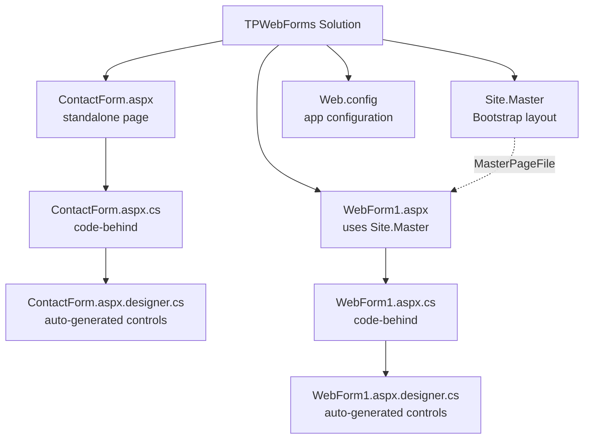
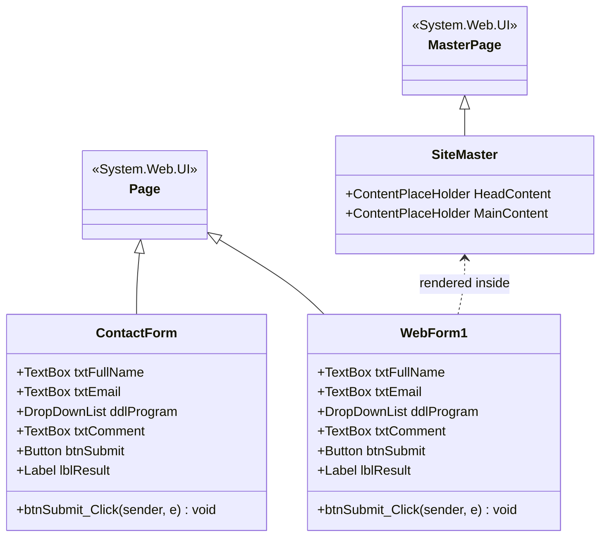
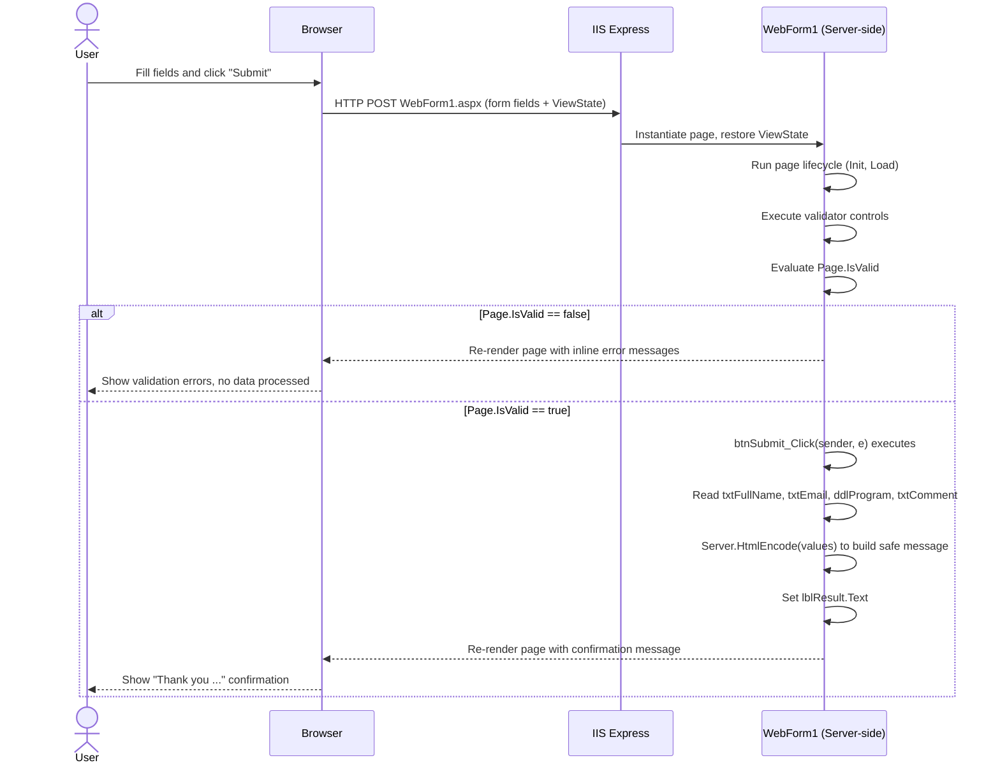
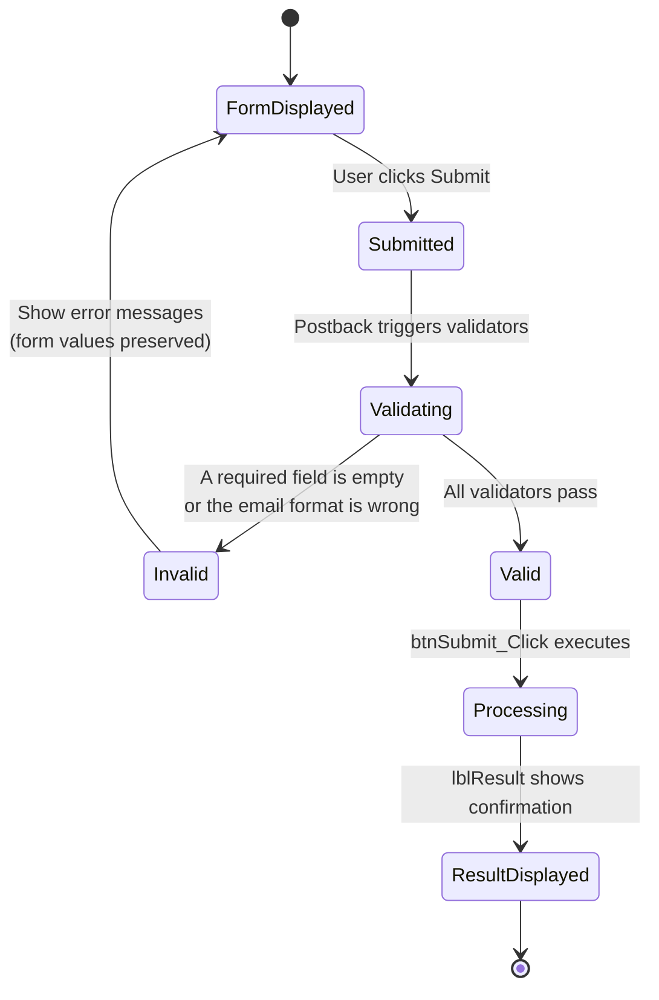

# ASP.NET Web Forms — Contact Form


A beginner-friendly **ASP.NET Web Forms** application built with **C# and .NET Framework 4.8**, demonstrating server-side controls, server-side validation, the classic **postback** lifecycle, and a Bootstrap-based master page layout.

This repository is the result of an introductory lab (*"Créer un premier formulaire ASP.NET Web Forms"*) and is intended as a **learning reference** for students who are new to ASP.NET Web Forms and to Visual Studio.

---

## Table of Contents

1. [Project Overview](#project-overview)
2. [Screenshots](#screenshots)
3. [Key Features](#key-features)
4. [Tech Stack](#tech-stack)
5. [Architecture & UML Diagrams](#architecture--uml-diagrams)
   - [Use Case Diagram](#use-case-diagram)
   - [Project Structure Diagram](#project-structure-diagram)
   - [Class Diagram](#class-diagram)
   - [Sequence Diagram — Postback Lifecycle](#sequence-diagram--postback-lifecycle)
   - [Activity / State Diagram — Validation Flow](#activity--state-diagram--validation-flow)
6. [Repository Structure](#repository-structure)
7. [Prerequisites](#prerequisites)
8. [Step 1 — Installing Visual Studio](#step-1--installing-visual-studio)
9. [Step 2 — Opening and Running the Project](#step-2--opening-and-running-the-project)
10. [Step 3 — Using the Application (User Walkthrough)](#step-3--using-the-application-user-walkthrough)
11. [Code Walkthrough (For Beginners)](#code-walkthrough-for-beginners)
12. [Configuration Notes](#configuration-notes)
13. [Known Limitations](#known-limitations)
14. [Suggested Exercises](#suggested-exercises)
15. [Troubleshooting](#troubleshooting)
16. [Comprehension Questions](#comprehension-questions)
17. [License](#license)

---

## Project Overview

This project is a simple **contact form** built with **ASP.NET Web Forms**. It teaches the fundamentals of the Web Forms model:

- How an `.aspx` page (markup) relates to its `.aspx.cs` code-behind file (server-side logic) and its `.aspx.designer.cs` file (auto-generated control declarations).
- How server controls (`TextBox`, `DropDownList`, `Button`, `Label`) work with the `runat="server"` attribute.
- How the **postback** mechanism sends the form back to the same page for server-side processing.
- How to use built-in **validator controls** (`RequiredFieldValidator`, `RegularExpressionValidator`) instead of writing manual validation logic.
- How a **Master Page** (`Site.Master`) provides a shared Bootstrap layout (navigation bar) across pages.

The solution contains **two versions of the same form**:

| Page | Layout | Purpose |
|---|---|---|
| `ContactForm.aspx` | Standalone page (its own `<html>`/`<body>`) | Original/simple version of the form |
| `WebForm1.aspx` | Uses `Site.Master` (Bootstrap navbar) | Same form, integrated into a shared site layout |

> **Deliberate scope limit:** submitted data is processed only in memory for the duration of the request. Nothing is written to a file or a database — this is not a real registration system, it is a teaching exercise focused on the Web Forms request/response cycle.

---

## Screenshots

> **Action needed from you:** this section is intentionally left as a gallery of placeholders. After you run the project (see [Step 2](#step-2--opening-and-running-the-project) and [Step 3](#step-3--using-the-application-user-walkthrough)), take the screenshots described below, save them under `docs/screenshots/` using the suggested file names, and they will render automatically here.

| # | Screenshot | File name |
|---|---|---|
| 1 | The empty contact form on first load | `docs/screenshots/01-form-empty.png` |
| 2 | The form filled with valid data, before submitting | `docs/screenshots/02-form-filled.png` |
| 3 | Validation errors shown after submitting an empty form | `docs/screenshots/03-validation-errors.png` |
| 4 | Invalid email format error | `docs/screenshots/04-invalid-email.png` |
| 5 | Successful submission confirmation message | `docs/screenshots/05-success-message.png` |

```markdown


```

---

## Key Features

- Server-side rendered form built entirely with ASP.NET Web Forms server controls.
- Full server-side validation (no custom JavaScript required):
  - Required full name
  - Required, format-checked email address (regular expression)
  - Required program/formation selection
  - Optional multi-line comment (max 500 characters)
- HTML-encoded output (`Server.HtmlEncode`) to prevent reflected markup/script injection in the confirmation message.
- Shared Bootstrap 4 layout via a Master Page (`Site.Master`) for the `WebForm1.aspx` version.
- Clean, card-style inline CSS for a modern look without any external UI framework dependency (on `ContactForm.aspx`).

---

## Tech Stack

| Layer | Technology |
|---|---|
| Language | C# |
| Framework | ASP.NET Web Forms (.NET Framework 4.8) |
| Web server (dev) | IIS Express |
| Front-end styling | Inline CSS / Bootstrap 4 (CDN, via `Site.Master`) |
| IDE | Visual Studio Enterprise 2026 Insiders (Visual Studio 2022 is also fully compatible) |
| Package management | NuGet (`packages.config`) |

---

## Architecture & UML Diagrams

All diagrams below are written in **Mermaid** and render natively on GitHub.

### Use Case Diagram


### Project Structure Diagram



### Class Diagram



### Sequence Diagram — Postback Lifecycle

This shows what happens between the moment the user clicks **Submit** and the moment the result is displayed, for the `WebForm1.aspx` page.



### Activity / State Diagram — Validation Flow



---

## Repository Structure

```
TPWebForms/
├── ContactForm.aspx              # Standalone contact form (markup)
├── ContactForm.aspx.cs           # Code-behind: submit handler logic
├── ContactForm.aspx.designer.cs  # Auto-generated control declarations
├── WebForm1.aspx                 # Contact form using the master page (markup)
├── WebForm1.aspx.cs              # Code-behind: submit handler logic
├── WebForm1.aspx.designer.cs     # Auto-generated control declarations
├── Site.Master                   # Shared layout with Bootstrap navbar
├── Web.config                    # Application configuration
├── Web.Debug.config              # Debug-specific config transform
├── Web.Release.config            # Release-specific config transform
├── packages.config               # NuGet package references
├── TPWebForms.csproj             # Project file (.NET Framework 4.8)
├── TPWebForms.slnx               # Visual Studio solution file
└── Properties/
    └── AssemblyInfo.cs
```

---

## Prerequisites

- A Windows computer.
- **Visual Studio 2022 (Community or higher)** or, as used for this project, **Visual Studio Enterprise 2026 Insiders**. The installation and project-creation steps are the same across both versions, aside from minor UI differences.
- In the **Visual Studio Installer**, the **".NET desktop development" / "ASP.NET and web development"** workload must be installed.
- The **".NET Framework project and item templates"** individual component must be available, so that the Web Forms template appears.

> **Important:** ASP.NET Web Forms runs on **.NET Framework**, not .NET Core / .NET 5+. When creating a new project, do not pick an "ASP.NET Core" template — it is a different technology and will not match this lab.

---

## Step 1 — Installing Visual Studio

This project was set up following these steps. If Visual Studio is already installed with the correct workload, skip to [Step 2](#step-2--opening-and-running-the-project).

1. Download **Visual Studio** from the official Visual Studio website (Community edition is free and sufficient; this project was built with Visual Studio Enterprise 2026 Insiders).
2. Run the downloaded installer.
3. In the **"Workloads"** tab, check **"ASP.NET and web development"**.
4. Open the **"Individual components"** tab and confirm that **".NET Framework project and item templates"** is checked.
5. At the bottom of the installer window, choose **"Download then install"** (recommended on a slower connection) or install directly.
6. Click **Install** (or **Modify**, if Visual Studio is already installed) and wait for the installer to finish.
7. Launch Visual Studio once installation completes.

> **Screenshot needed — Step 1:** capture the Visual Studio Installer with the **"ASP.NET and web development"** workload checked.
> ``

---

## Step 2 — Opening and Running the Project

### 2.1 Open the solution

1. Launch **Visual Studio**.
2. Click **"Open a project or solution"** and select `TPWebForms.slnx` (or `TPWebForms.sln`, depending on your checkout).

> **Screenshot needed — Step 2.1:** Visual Studio's start screen with the solution being opened.
> ``

### 2.2 Inspect the Solution Explorer

Once the solution is loaded, the **Solution Explorer** should show the project structure described in [Repository Structure](#repository-structure): `Site.Master`, `ContactForm.aspx`, `WebForm1.aspx`, `Web.config`, etc.

> **Screenshot needed — Step 2.2:** Solution Explorer panel showing the project tree.
> ``

### 2.3 Restore NuGet packages (if prompted)

If Visual Studio shows a yellow warning banner about missing NuGet packages, right-click the solution in **Solution Explorer** and choose **"Restore NuGet Packages"**.

### 2.4 Set the startup page

1. In **Solution Explorer**, right-click `WebForm1.aspx` (or `ContactForm.aspx`, depending on which version you want to test).
2. Choose **"Set As Start Page"**.

> **Screenshot needed — Step 2.4:** right-click context menu showing **"Set As Start Page"**.
> ``

### 2.5 Run the application

1. Press **F5** to run with debugging, or **Ctrl+F5** to run without debugging.
2. Visual Studio will start **IIS Express** and open your default browser automatically, pointing to a local address such as `https://localhost:44373/WebForm1.aspx`.

> **Screenshot needed — Step 2.5:** the running application open in the browser, right after launch.
> ``

---

## Step 3 — Using the Application (User Walkthrough)

Follow these steps to exercise every feature of the form. This is the same manual test sequence used to validate the lab.

1. **Load the page.** Observe the title, the four fields (Full name, Email address, Program, Comment) and the **Submit** button.
2. **Submit the empty form.** Click **Submit** without typing anything. Every required field should display its own red validation message, and the page should not navigate away.

   > **Screenshot needed — Step 3.2:** form showing all validation error messages at once.
   > ``

3. **Enter an invalid email**, e.g. `not-an-email`, fill the other required fields correctly, and click **Submit**. The email format validator should report the error while the other fields are accepted.

   > **Screenshot needed — Step 3.3:** invalid email format error message.
   > ``

4. **Fill the form correctly**: enter a full name, a valid email address, select a program from the dropdown, and optionally type a comment.

   > **Screenshot needed — Step 3.4:** fully and correctly filled form, before clicking Submit.
   > ``

5. **Click Submit.** A green confirmation message should appear below the button, repeating the submitted name, selected program, and email address.

   > **Screenshot needed — Step 3.5:** confirmation message after a successful submission.
   > ``

6. **Change the comment and submit again** to confirm the form can be resubmitted and the confirmation message updates accordingly.

---

## Code Walkthrough (For Beginners)

If you are new to ASP.NET Web Forms, this section explains what each file does and how they connect.

### `.aspx` vs `.aspx.cs` vs `.aspx.designer.cs`

| File | Role |
|---|---|
| `WebForm1.aspx` | The **markup** file: HTML plus ASP.NET server control tags (`<asp:TextBox>`, `<asp:Button>`, …). This is what defines the visual layout. |
| `WebForm1.aspx.cs` | The **code-behind** file: C# logic that runs on the server, such as the `btnSubmit_Click` event handler. |
| `WebForm1.aspx.designer.cs` | **Auto-generated** by Visual Studio. It declares one C# field per server control (matched by `ID`) so the code-behind can reference `txtFullName`, `ddlProgram`, etc. **Never edit this file manually** — Visual Studio regenerates it whenever the markup changes. |

### `runat="server"`

Any HTML/ASP.NET control marked `runat="server"` becomes an object that the C# code-behind can read and modify (for example `txtFullName.Text`). Without this attribute, a control is just static HTML and the server cannot interact with it.

### The postback model

ASP.NET Web Forms uses a **postback**: clicking the Submit button sends the entire form back to the *same* page via an HTTP POST. The server re-creates the page, restores its state (via **ViewState**), runs the validators, and then executes the event handler tied to the button (`OnClick="btnSubmit_Click"`). The result is rendered back into the same page — there is no separate "results" page. This flow is detailed in the [sequence diagram](#sequence-diagram--postback-lifecycle) above.

### Validator controls

Instead of writing manual `if` checks in C#, the markup declares validator controls next to each input:

- `RequiredFieldValidator` — blocks submission if the associated field is empty.
- `RegularExpressionValidator` — checks the email field against a regular expression (`^[^@\s]+@[^@\s]+\.[^@\s]+$`).

Before processing any data, the code-behind checks:

```csharp
if (!Page.IsValid)
{
    lblResult.Text = "";
    return;
}
```

`Page.IsValid` becomes `true` only if every validator on the page passed. This prevents the handler from processing incomplete or malformed data.

### The submit handler

```csharp
protected void btnSubmit_Click(object sender, EventArgs e)
{
    if (!Page.IsValid)
    {
        lblResult.Text = "";
        return;
    }

    string fullName = txtFullName.Text.Trim();
    string email = txtEmail.Text.Trim();
    string program = ddlProgram.SelectedItem.Text;
    string comment = txtComment.Text.Trim();

    lblResult.Text = "Thank you " + Server.HtmlEncode(fullName) +
                     "! Your form was processed. " +
                     "Program: " + Server.HtmlEncode(program) +
                     ". A summary could be sent to " +
                     Server.HtmlEncode(email) + ".";

    // The comment is read, but the submitted information is not stored.
}
```

Key points for beginners:

- `Server.HtmlEncode(...)` escapes any HTML/script characters the user typed, so the confirmation message cannot be used to inject markup into the page (basic XSS protection).
- The comment field is read into a local variable purely to demonstrate retrieving a multi-line input — it is not persisted anywhere.
- `lblResult` is an `asp:Label` with `EnableViewState="false"`, meaning its text is not remembered across further postbacks unless explicitly set again.

### The Master Page (`Site.Master`)

`WebForm1.aspx` declares `MasterPageFile="~/Site.Master"`. The master page defines the outer HTML shell, the Bootstrap 4 navigation bar, and two placeholders:

- `HeadContent` — lets child pages inject extra `<head>` content (e.g., page-specific `<style>` blocks).
- `MainContent` — where the child page's body content is inserted.

`ContactForm.aspx`, by contrast, does **not** use a master page — it defines its own complete `<html>` document, which is why its markup includes a full `<head>` and `<body>`.

---

## Configuration Notes

`Web.config` contains this setting:

```xml
<appSettings>
  <add key="ValidationSettings:UnobtrusiveValidationMode" value="None" />
</appSettings>
```

By default, ASP.NET Web Forms uses **unobtrusive client-side validation**, which relies on jQuery being correctly mapped as a script resource. For a first lab that focuses on **server-side** validators, setting this mode to `None` avoids a configuration error and keeps the example simple (see [Troubleshooting](#troubleshooting) below).

---

## Known Limitations

- **No persistence.** Submitted data is used only to build the confirmation message for that single request; nothing is written to a database, file, or session.
- **No authentication or authorization.** The form is open to any visitor.
- **No anti-forgery/CSRF token.** Acceptable for a local teaching lab, but would need to be addressed before any real-world deployment.
- **Minimal styling**, intended to keep the markup readable for beginners rather than to be production-ready UI.

---

## Suggested Exercises

To practice further with this codebase, try implementing:

- Add a **"Phone number"** field and make it required.
- Add a **"Education level"** dropdown list.
- Add a **"Reset"** button that clears all fields and the confirmation message.
- Display a more complete summary of all submitted information (including the comment).
- Add a **live character counter** for the comment field (maximum 500 characters).

---

## Troubleshooting

**Error:** *"WebForms UnobtrusiveValidationMode requires a ScriptResourceMapping for 'jquery'..."*

**Cause:** The default unobtrusive validation mode expects a jQuery script mapping that is not configured in this minimal project.

**Fix:** Ensure `Web.config` contains the `appSettings` entry shown in [Configuration Notes](#configuration-notes). If it is missing, add it manually and restart the application.

---

## Comprehension Questions

These questions are useful for self-assessment after completing the lab:

1. What is the difference between `WebForm1.aspx` and `WebForm1.aspx.cs`?
2. What does the `runat="server"` attribute do?
3. What role does the `btnSubmit_Click` event play?
4. Why does the code check `Page.IsValid` before processing the submitted fields?
5. What happens if the browser is closed after submitting the form? Is the data kept? Why or why not?

---

## License

This project is distributed under the **MIT License** and is intended for educational purposes as part of an ASP.NET Web Forms introductory lab.
