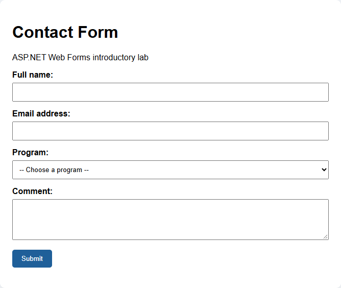
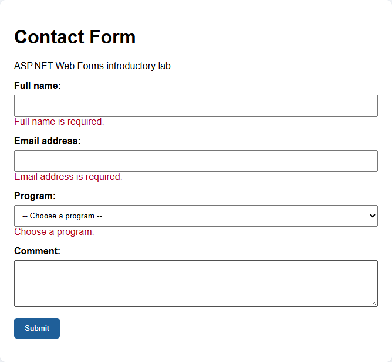
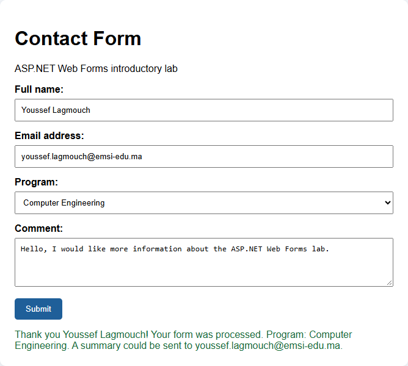
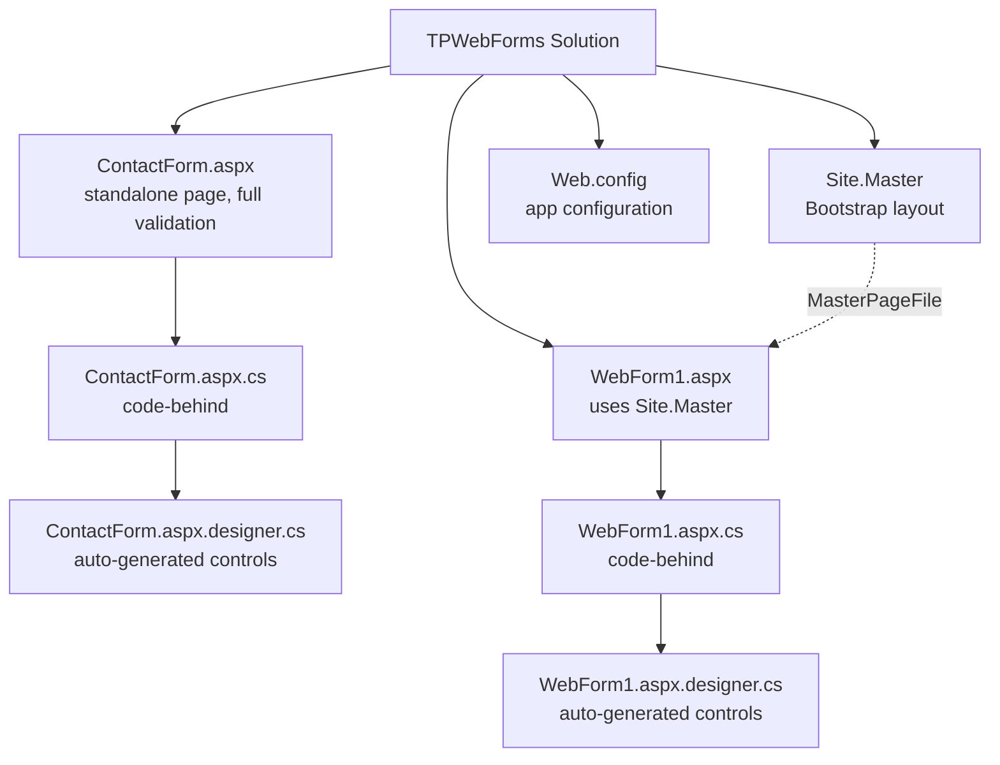
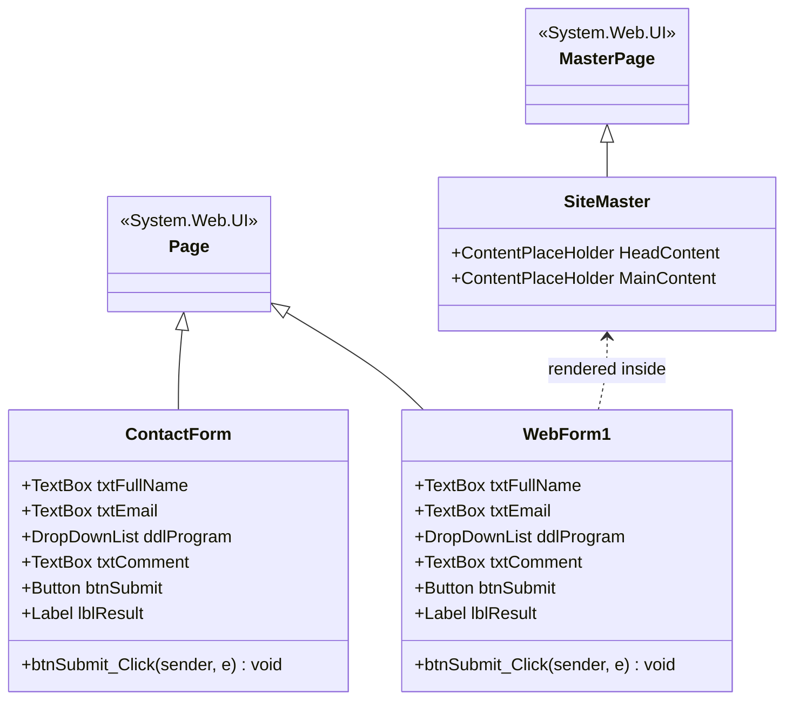
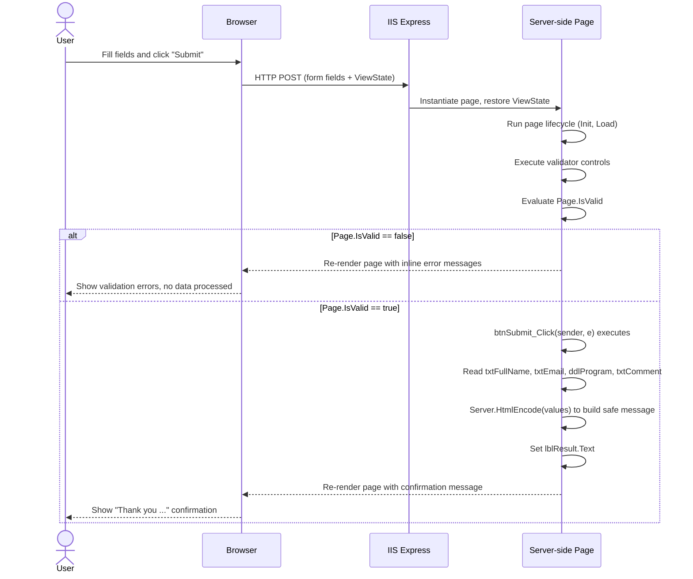
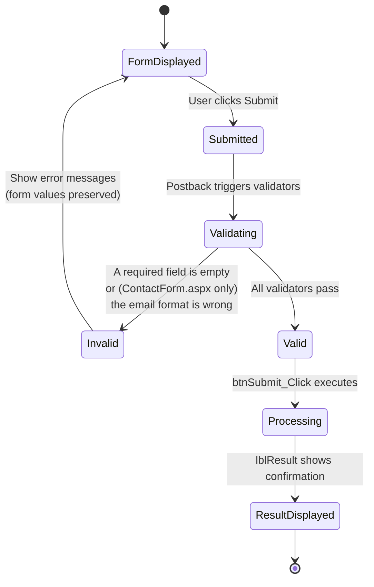
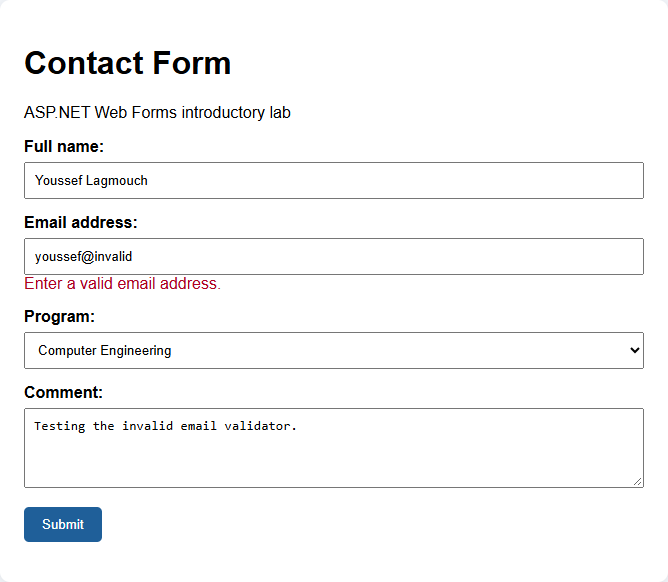
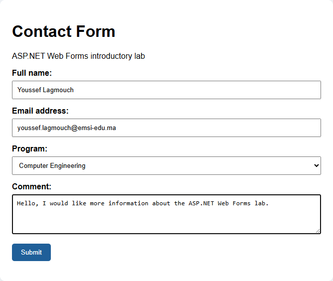
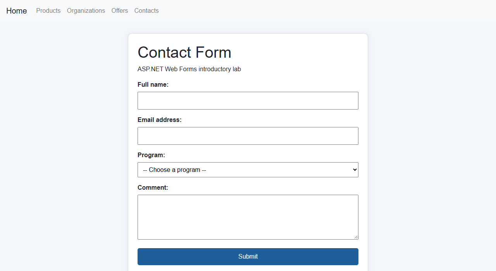

<div align="center">

### 📬 A complete, beginner-friendly ASP.NET Web Forms contact form

[](https://dotnet.microsoft.com/)
[](https://learn.microsoft.com/dotnet/csharp/)
[](https://learn.microsoft.com/aspnet/web-forms/overview/)
[](https://www.iis.net/downloads/microsoft/iis-express)
[](https://visualstudio.microsoft.com/)
[](LICENSE)

*A responsive-free, server-rendered ASP.NET Web Forms project demonstrating server controls,
server-side validation, the classic postback lifecycle, and a Bootstrap master page — plus a
zero-to-hero tutorial for anyone who has never opened Visual Studio before.* 🎓

</div>

---

## 🎬 Demo

| Empty form | Required-field errors | Success confirmation |
|---|---|---|
|  |  |  |

> 🖼️ These are **real captures of this exact repository**: the project was built with MSBuild,
> served locally with IIS Express, and driven end-to-end with a headless Chrome session that
> actually filled the fields and clicked **Submit**. No mockups.

---

## 📑 Table of Contents

- [✨ Features](#-features)
- [🛠️ Tech Stack](#️-tech-stack)
- [🏗️ Architecture (UML / Mermaid)](#️-architecture-uml--mermaid)
- [📂 Project Structure](#-project-structure)
- [🧪 Key Files Walkthrough](#-key-files-walkthrough)
- [🆚 ContactForm.aspx vs WebForm1.aspx](#-contactformaspx-vs-webform1aspx)
- [🧠 How the Code Works (For Beginners)](#-how-the-code-works-for-beginners)
- [✅ Prerequisites](#-prerequisites)
- [🚀 Quick Start](#-quick-start)
- [🎓 Full Beginner Tutorial — From Zero to Running App](#-full-beginner-tutorial--from-zero-to-running-app)
- [🖥️ Screenshots](#️-screenshots)
- [🐞 Troubleshooting](#-troubleshooting)
- [🗺️ Roadmap](#️-roadmap)
- [📄 License](#-license)
- [🙌 Acknowledgments](#-acknowledgments)

---

## ✨ Features

- 🧱 **Two layout variants** of the same form: a self-contained standalone page
  (`ContactForm.aspx`) and a page sharing a Bootstrap 4 **Master Page** (`WebForm1.aspx` +
  `Site.Master`).
- ✅ **Server-side validation** with built-in validator controls — no custom JavaScript:
  required full name, required + **regex-checked** email, required program selection.
- 🔄 **Classic ASP.NET postback lifecycle** — the form posts back to itself, runs validators,
  and re-renders with either error messages or a confirmation banner.
- 🔒 **HTML-encoded output** (`Server.HtmlEncode`) in the confirmation message, preventing
  reflected markup/script injection.
- 📚 **A full "from zero" learning path** below — every click a beginner needs in Visual
  Studio, in order, with real screenshots of this repository actually running.

---

## 🛠️ Tech Stack

| Layer | Technology |
|---|---|
| Language | C# |
| Framework | ASP.NET Web Forms (.NET Framework **4.8**) |
| UI Toolkit | Inline CSS / Bootstrap 4 (CDN, via `Site.Master`) |
| Package manager | NuGet (`packages.config` — classic, non-SDK-style `.csproj`) |
| Local web server | IIS Express |
| IDE | Visual Studio 2022 / **Visual Studio Enterprise 2026 Insiders**, workload *ASP.NET and web development* |
| Build | MSBuild (`Debug` / `Release` configurations, `Web.Debug.config` / `Web.Release.config`) |

---

## 🏗️ Architecture (UML / Mermaid)

### 1️⃣ Use Case Diagram


### 2️⃣ Project Structure Diagram



### 3️⃣ Class Diagram — who inherits from what



### 4️⃣ Sequence Diagram — postback lifecycle



### 5️⃣ Activity / State Diagram — validation flow



---

## 📂 Project Structure

```
aspnet-webforms-contact-form/
├── ContactForm.aspx              # Standalone contact form (markup) — full validation
├── ContactForm.aspx.cs           # Code-behind: submit handler logic
├── ContactForm.aspx.designer.cs  # Auto-generated control declarations
├── WebForm1.aspx                 # Contact form using the master page (markup)
├── WebForm1.aspx.cs              # Code-behind: submit handler logic
├── WebForm1.aspx.designer.cs     # Auto-generated control declarations
├── Site.Master                   # Shared layout with Bootstrap navbar
├── Web.config                    # Application configuration
├── Web.Debug.config              # Debug-specific config transform
├── Web.Release.config            # Release-specific config transform
├── packages.config               # NuGet package references
├── TPWebForms.csproj             # Project file (.NET Framework 4.8)
├── TPWebForms.slnx               # Visual Studio solution file
├── .gitignore                    # Excludes bin/, obj/, .vs/, packages/ (restored at build time)
├── docs/
│   └── screenshots/              # Every screenshot used throughout this README
└── Properties/
    └── AssemblyInfo.cs
```

> `bin/`, `obj/`, `.vs/`, and `packages/` are intentionally **not** committed — they are build
> output and restored NuGet packages, regenerated automatically the first time you build the
> solution.

---

## 🧪 Key Files Walkthrough

| File | Role |
|---|---|
| `ContactForm.aspx` / `.aspx.cs` | Standalone form page — full markup + logic in one pair, no master page |
| `WebForm1.aspx` / `.aspx.cs` | Same form concept, rendered inside `Site.Master`'s Bootstrap layout |
| `*.aspx.designer.cs` | Auto-generated field declarations for server controls — never edit by hand |
| `Site.Master` | Shared page shell: Bootstrap 4 navbar + `HeadContent`/`MainContent` placeholders |
| `Web.config` | App settings, including the `UnobtrusiveValidationMode` fix (see [Troubleshooting](#-troubleshooting)) |
| `TPWebForms.csproj` | MSBuild project file targeting `.NET Framework 4.8` |
| `packages.config` | NuGet package references (e.g. `Microsoft.CodeDom.Providers.DotNetCompilerPlatform`) |

---

## 🆚 ContactForm.aspx vs WebForm1.aspx

While capturing the screenshots in this README, a real behavioral difference between the two
pages was confirmed — worth knowing before you use either one as a template:

| Aspect | `ContactForm.aspx` | `WebForm1.aspx` |
|---|---|---|
| Layout | Self-contained `<html>` document | Uses `Site.Master` (Bootstrap navbar) |
| Full name validation | Required | Required |
| Email validation | **Required + regex format check** | **Required only** — no format/regex validator is declared |
| Program options | Computer Engineering, Industrial Engineering, Networks and Systems | Computer Engineering, Networks and Systems *(Industrial Engineering is not listed)* |
| Comment field | Optional, max 500 characters | Optional, max 500 characters |

> This was verified by posting directly to each page: submitting a syntactically-invalid email
> to `ContactForm.aspx` correctly triggers *"Enter a valid email address."*, while the same
> value submitted to `WebForm1.aspx` is silently accepted because no `RegularExpressionValidator`
> exists on that page. If you build on `WebForm1.aspx`, consider adding the same email-format
> validator used in `ContactForm.aspx`.

---

## 🧠 How the Code Works (For Beginners)

### `.aspx` vs `.aspx.cs` vs `.aspx.designer.cs`

| File | Role |
|---|---|
| `WebForm1.aspx` | The **markup** file: HTML plus ASP.NET server control tags (`<asp:TextBox>`, `<asp:Button>`, …). Defines the visual layout. |
| `WebForm1.aspx.cs` | The **code-behind** file: C# logic that runs on the server, such as the `btnSubmit_Click` event handler. |
| `WebForm1.aspx.designer.cs` | **Auto-generated** by Visual Studio. It declares one C# field per server control (matched by `ID`) so the code-behind can reference `txtFullName`, `ddlProgram`, etc. **Never edit this file manually.** |

### `runat="server"`

Any HTML/ASP.NET control marked `runat="server"` becomes an object the C# code-behind can read
and modify (for example `txtFullName.Text`). Without this attribute, a control is just static
HTML and the server cannot interact with it.

### The postback model

ASP.NET Web Forms uses a **postback**: clicking Submit sends the entire form back to the *same*
page via an HTTP POST. The server re-creates the page, restores its state (via **ViewState**),
runs the validators, and then executes the event handler tied to the button
(`OnClick="btnSubmit_Click"`). The result is rendered back into the same page — see the
[sequence diagram](#️-architecture-uml--mermaid) above for the full flow.

### Validator controls

Instead of manual `if` checks in C#, the markup declares validator controls next to each input:

- `RequiredFieldValidator` — blocks submission if the associated field is empty.
- `RegularExpressionValidator` — checks the email field against
  `^[^@\s]+@[^@\s]+\.[^@\s]+$`. **Only present on `ContactForm.aspx`** (see the
  [comparison table](#-contactformaspx-vs-webform1aspx) above).

Before processing any data, the code-behind checks:

```csharp
if (!Page.IsValid)
{
    lblResult.Text = "";
    return;
}
```

`Page.IsValid` becomes `true` only if every validator on the page passed.

### The submit handler

```csharp
protected void btnSubmit_Click(object sender, EventArgs e)
{
    if (!Page.IsValid)
    {
        lblResult.Text = "";
        return;
    }

    string fullName = txtFullName.Text.Trim();
    string email = txtEmail.Text.Trim();
    string program = ddlProgram.SelectedItem.Text;
    string comment = txtComment.Text.Trim();

    lblResult.Text = "Thank you " + Server.HtmlEncode(fullName) +
                     "! Your form was processed. " +
                     "Program: " + Server.HtmlEncode(program) +
                     ". A summary could be sent to " +
                     Server.HtmlEncode(email) + ".";

    // The comment is read, but the submitted information is not stored.
}
```

- `Server.HtmlEncode(...)` escapes any HTML/script characters the user typed, so the
  confirmation message cannot be used to inject markup into the page.
- The comment is read purely to demonstrate retrieving multi-line input — it is not persisted.
- `lblResult` has `EnableViewState="false"`, so its text is not remembered across further
  postbacks unless explicitly set again.

### The Master Page (`Site.Master`)

`WebForm1.aspx` declares `MasterPageFile="~/Site.Master"`. The master page defines the outer
HTML shell, the Bootstrap 4 navbar, and two placeholders — `HeadContent` and `MainContent` —
where child pages inject their own content. Because `WebForm1.aspx` lives inside
`MainContent`, its rendered control IDs are prefixed (e.g. `MainContent_txtEmail`).
`ContactForm.aspx` does **not** use a master page, so its IDs have no prefix.

---

## ✅ Prerequisites

| Tool | Why you need it |
|---|---|
| Windows computer | Visual Studio + IIS Express are Windows-only |
| **Visual Studio 2022 (Community+)** or **Visual Studio Enterprise 2026 Insiders** | IDE used to build and run the project |
| **"ASP.NET and web development"** workload | Installed via the Visual Studio Installer; required for Web Forms templates |
| **".NET Framework project and item templates"** component | Makes the Web Forms project template available |
| **.NET Framework 4.8** | Target framework of this project |

> ⚠️ **Important:** ASP.NET Web Forms runs on **.NET Framework**, not .NET Core / .NET 5+. When
> creating a new project, do not pick an "ASP.NET Core" template — it is a different technology
> and will not match this lab.

---

## 🚀 Quick Start

For readers already comfortable with Visual Studio:

```text
1. Clone this repository:
   git clone https://github.com/Lagmouchyoussef/aspnet-webforms-contact-form.git
2. Open TPWebForms.slnx (or TPWebForms.sln) in Visual Studio.
3. Right-click the solution → Restore NuGet Packages (first build will do this automatically too).
4. Right-click ContactForm.aspx or WebForm1.aspx → Set As Start Page.
5. Press F5 (debug) or Ctrl+F5 (no debug).
6. Visual Studio launches IIS Express and opens your default browser.
```

If you are new to Visual Studio or ASP.NET Web Forms, continue to the full tutorial below.

---

## 🎓 Full Beginner Tutorial — From Zero to Running App

### Part A — Install Visual Studio

1. Download **Visual Studio** from the official Visual Studio website (Community edition is
   free and sufficient).
2. Run the installer and open the **"Workloads"** tab.
3. Check **"ASP.NET and web development"**.
4. Open the **"Individual components"** tab and confirm **".NET Framework project and item
   templates"** is checked.
5. Click **Install** (or **Modify**, if Visual Studio is already installed) and wait for it to
   finish, then launch Visual Studio.

### Part B — Create (or open) the project

6. From the Visual Studio start screen, click **"Create a new project"**.
7. Search for the **"ASP.NET Web Application (.NET Framework)"** template (C#), name the
   project, choose a location, and select **.NET Framework 4.8**.
8. In the template picker, choose **"Web Forms"**, then click **Create**.
9. Visual Studio generates the solution. In **Solution Explorer**, you'll see the project tree
   with `Web.config`, `packages.config`, and the default folders.

> For **this repository specifically**, skip steps 6–9 and instead clone it (see
> [Quick Start](#-quick-start)) — the project already exists.

### Part C — Add a Web Form (if starting from scratch)

10. Right-click the project → **Add** → **New Item** → select **Web Form**, name it, and click
    **Add**.
11. Build the form markup with server controls (`asp:TextBox`, `asp:DropDownList`,
    `asp:Button`, validators) as shown in [Key Files Walkthrough](#-key-files-walkthrough) and
    [How the Code Works](#-how-the-code-works-for-beginners) above.

### Part D — Run and test

12. Right-click `ContactForm.aspx` (or `WebForm1.aspx`) → **"Set As Start Page"**.
13. Press **F5** (debug) or **Ctrl+F5** (no debug). Visual Studio starts **IIS Express** and
    opens your browser.
14. Test the full scenario below in [Screenshots](#️-screenshots).

---

## 🖥️ Screenshots

This is the exact scenario sequence used to produce the captures in this README — reproduce it
yourself to confirm the app behaves identically:

1. **Load the page.** Observe the title, the four fields (Full name, Email address, Program,
   Comment) and the **Submit** button.

   

2. **Submit the empty form.** Click **Submit** without typing anything — every required field
   shows its own red validation message.

   

3. **Enter a syntactically-invalid email** (missing a dot), fill the other required fields, and
   submit — on `ContactForm.aspx` the format validator blocks it.

   

4. **Fill the form correctly**: full name, a valid email, a selected program, and an optional
   comment.

   

5. **Click Submit.** A confirmation message appears below the button, repeating the submitted
   name, program, and email.

   

6. **Change the comment and submit again** to confirm the form can be resubmitted and the
   confirmation message updates accordingly.

### Bootstrap layout variant (`WebForm1.aspx`)



---

## 🐞 Troubleshooting

| Symptom | Cause | Fix |
|---|---|---|
| *"WebForms UnobtrusiveValidationMode requires a ScriptResourceMapping for 'jquery'..."* | The default unobtrusive validation mode expects a jQuery script mapping that isn't configured in this minimal project. | Add the `appSettings` entry below to `Web.config`. |
| An obviously malformed email is accepted on `WebForm1.aspx` | That page only declares a `RequiredFieldValidator` for the email field — no format validator | Expected behavior for this page (see [comparison table](#-contactformaspx-vs-webform1aspx)); use `ContactForm.aspx` if you need format checking. |
| `MSB1008` / command-line build errors mentioning stray paths | Running MSBuild from a Unix-style shell (e.g. Git Bash) mangles `/p:` style switches | Run MSBuild from PowerShell or the Developer Command Prompt instead. |

```xml
<appSettings>
  <add key="ValidationSettings:UnobtrusiveValidationMode" value="None" />
</appSettings>
```

The `UnobtrusiveValidationMode` setting relies on jQuery being correctly mapped as a script
resource. For a first lab focused on **server-side** validators, setting this mode to `None`
avoids the error above and keeps the example simple.

---

## 🗺️ Roadmap

- [ ] Add a **"Phone number"** field, required.
- [ ] Add an **"Education level"** dropdown list.
- [ ] Add a **"Reset"** button that clears all fields and the confirmation message.
- [ ] Show a more complete summary of all submitted information (including the comment).
- [ ] Add a **live character counter** for the comment field (maximum 500 characters).
- [ ] Bring `WebForm1.aspx` to parity with `ContactForm.aspx`: add the missing email-format
      validator and the missing "Industrial Engineering" program option.

**Known, deliberate limitations:** no persistence (data lives only for the duration of the
request), no authentication, and no anti-forgery token — this is a teaching lab, not a
production registration system.

---

## 📄 License

This project is distributed under the **MIT License** and is intended for educational purposes
as part of an ASP.NET Web Forms introductory lab.

---

## 🙌 Acknowledgments

- This lab follows the structure of the **EMSI DotNet Maarif** ASP.NET Web Forms workshop.
- Every screenshot in this README is a live, English-language capture of this repository
  actually running.

---

<div align="center">

**Youssef Lagmouch**

</div>
