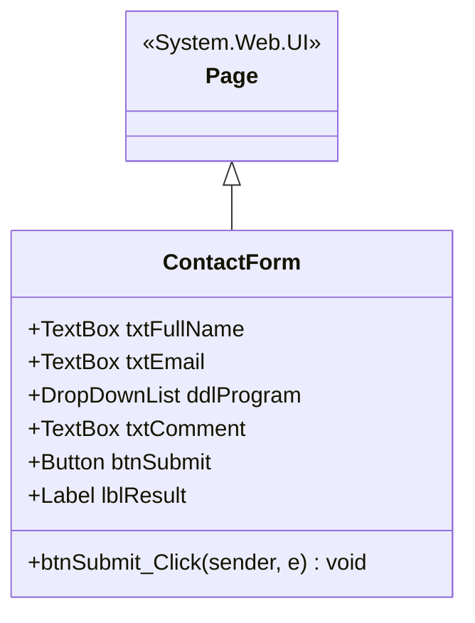
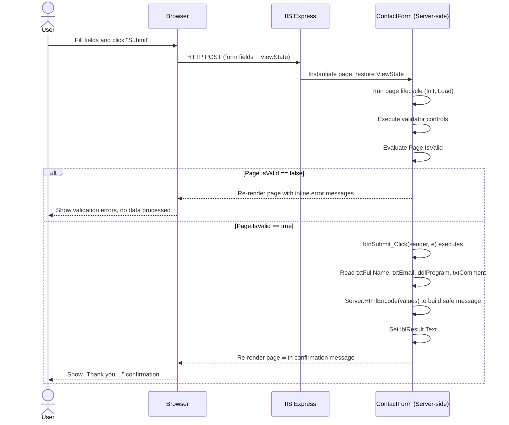

# ASP.NET Web Forms — Contact Form


A first hands-on lab in **ASP.NET Web Forms**, built with **C# and .NET Framework 4.8** in
**Visual Studio Enterprise 2026 Insiders**. It creates a single contact form page that
demonstrates server controls, server-side validation, and the Web Forms postback model —
no front-end framework, no master page, nothing but the ASP.NET fundamentals.

---

## Table of Contents

1. [Objectives](#objectives)
2. [Prerequisites](#prerequisites)
3. [Project Structure](#project-structure)
4. [Architecture (UML / Mermaid)](#architecture-uml--mermaid)
5. [Step 1 — Create the Project](#step-1--create-the-project)
6. [Step 2 — Build the Form Interface](#step-2--build-the-form-interface)
7. [Step 3 — Program the Submit Button in C#](#step-3--program-the-submit-button-in-c)
8. [Step 4 — Run and Test the Application](#step-4--run-and-test-the-application)
9. [Expected Result](#expected-result)
10. [How the Code Works](#how-the-code-works)
11. [Configuration Notes](#configuration-notes)
12. [Troubleshooting](#troubleshooting)
13. [Comprehension Questions](#comprehension-questions)
14. [Suggested Exercises](#suggested-exercises)
15. [License](#license)

---

## Objectives

By the end of this lab you will be able to:

- Create an ASP.NET Web Forms project based on .NET Framework, in Visual Studio Enterprise 2026
  Insiders.
- Identify the files that make up a Web Forms page: `.aspx` and `.aspx.cs`.
- Use server controls: `TextBox`, `DropDownList`, `Button`, and `Label`.
- Understand the postback and how a server-side event is handled.
- Set up simple server-side validation and test the application in a browser.

---

## Prerequisites

| Requirement | Details |
|---|---|
| Operating system | Windows |
| IDE | **Visual Studio Enterprise 2026 Insiders** (or Visual Studio 2022 Community and above) |
| Workload | **"ASP.NET and web development"**, installed via the Visual Studio Installer |
| Component | **".NET Framework project and item templates"**, under Individual Components |
| Target framework | **.NET Framework 4.8** |

> **Important:** ASP.NET Web Forms runs on **.NET Framework**, not .NET Core / .NET 5+. When
> creating the project, do not select an "ASP.NET Core" template — it is a different technology.

If the Web Forms template does not appear in Visual Studio, close Visual Studio, open
**Visual Studio Installer → Modify**, install the **ASP.NET and web development** workload and
the required .NET Framework components, then relaunch Visual Studio.

---

## Project Structure

```
aspnet-webforms-contact-form/
├── ContactForm.aspx              # The contact form page (markup)
├── ContactForm.aspx.cs           # Code-behind: Submit button event handler
├── ContactForm.aspx.designer.cs  # Auto-generated control declarations
├── Web.config                    # Application configuration
├── Web.Debug.config              # Debug-specific config transform
├── Web.Release.config            # Release-specific config transform
├── packages.config               # NuGet package references
├── TPWebForms.csproj             # Project file (.NET Framework 4.8)
├── TPWebForms.slnx               # Visual Studio solution file
├── .gitignore                    # Excludes bin/, obj/, .vs/, packages/
├── docs/
│   └── screenshots/              # Screenshots used throughout this README
└── Properties/
    └── AssemblyInfo.cs
```

> `bin/`, `obj/`, `.vs/`, and `packages/` are intentionally not committed — they are build
> output and restored NuGet packages, regenerated the first time the solution is built.

---

## Architecture (UML / Mermaid)

### Class Diagram



### Sequence Diagram — Postback Lifecycle



### Activity / State Diagram — Validation Flow


---

## Step 1 — Create the Project

1. Open **Visual Studio Enterprise 2026 Insiders**.
2. Click **"Create a new project"**.
3. Search for the **"ASP.NET Web Application (.NET Framework)"** template, in C#.
4. Click **Next**, name the project (e.g. `TPWebForms`), choose a location, and click **Create**.
5. In the template selection window, choose **"Web Forms"**.
6. Select an installed **.NET Framework** version (e.g. **4.8**) and confirm creation.

> To work with **this exact repository** instead of starting from scratch, clone it and open
> `TPWebForms.slnx` directly:
> ```
> git clone https://github.com/Lagmouchyoussef/aspnet-webforms-contact-form.git
> ```

The `Web.config` file contains the application's configuration settings.

---

## Step 2 — Build the Form Interface

1. Right-click the project → **Add** → **New Item**.
2. Select **Web Form**, name it (this project's version is `ContactForm.aspx`), and click **Add**.
3. Replace the generated markup with server controls for each field, plus a validator next to
   each one that needs validation:

```aspx
<asp:Label ID="lblFullName" runat="server" AssociatedControlID="txtFullName" Text="Full name:" />
<asp:TextBox ID="txtFullName" runat="server" CssClass="input" MaxLength="80" />
<asp:RequiredFieldValidator ID="valFullName" runat="server"
    ControlToValidate="txtFullName" ErrorMessage="Full name is required."
    CssClass="error" Display="Dynamic" />

<asp:Label ID="lblEmail" runat="server" AssociatedControlID="txtEmail" Text="Email address:" />
<asp:TextBox ID="txtEmail" runat="server" CssClass="input" TextMode="Email" MaxLength="120" />
<asp:RequiredFieldValidator ID="valEmailRequired" runat="server"
    ControlToValidate="txtEmail" ErrorMessage="Email address is required."
    CssClass="error" Display="Dynamic" />
<asp:RegularExpressionValidator ID="valEmailFormat" runat="server"
    ControlToValidate="txtEmail" ValidationExpression="^[^@\s]+@[^@\s]+\.[^@\s]+$"
    ErrorMessage="Enter a valid email address." CssClass="error" Display="Dynamic" />

<asp:Label ID="lblProgram" runat="server" AssociatedControlID="ddlProgram" Text="Program:" />
<asp:DropDownList ID="ddlProgram" runat="server" CssClass="input">
    <asp:ListItem Text="-- Choose a program --" Value="" />
    <asp:ListItem Text="Computer Engineering" Value="ComputerEngineering" />
    <asp:ListItem Text="Industrial Engineering" Value="IndustrialEngineering" />
    <asp:ListItem Text="Networks and Systems" Value="NetworksAndSystems" />
</asp:DropDownList>
<asp:RequiredFieldValidator ID="valProgram" runat="server"
    ControlToValidate="ddlProgram" InitialValue="" ErrorMessage="Choose a program."
    CssClass="error" Display="Dynamic" />

<asp:Label ID="lblComment" runat="server" AssociatedControlID="txtComment" Text="Comment:" />
<asp:TextBox ID="txtComment" runat="server" CssClass="input" TextMode="MultiLine"
    Rows="4" MaxLength="500" />

<asp:Button ID="btnSubmit" runat="server" Text="Submit" CssClass="button" OnClick="btnSubmit_Click" />
<asp:Label ID="lblResult" runat="server" CssClass="success" EnableViewState="false" />
```

---

## Step 3 — Program the Submit Button in C#

Double-click the **Submit** button in the designer to generate its `Click` event handler in the
code-behind file:

```csharp
protected void btnSubmit_Click(object sender, EventArgs e)
{
    // Server-side check of the validator controls.
    if (!Page.IsValid)
    {
        lblResult.Text = "";
        return;
    }

    string fullName = txtFullName.Text.Trim();
    string email = txtEmail.Text.Trim();
    string program = ddlProgram.SelectedItem.Text;
    string comment = txtComment.Text.Trim();

    // The Label control HTML-encodes the text it displays.
    lblResult.Text = "Thank you " + Server.HtmlEncode(fullName) +
                     "! Your form was processed. " +
                     "Program: " + Server.HtmlEncode(program) +
                     ". A summary could be sent to " +
                     Server.HtmlEncode(email) + ".";

    // The comment is read to demonstrate retrieving multi-line input.
    // No data is stored.
}
```

**Key takeaways:** any ASP.NET control with `runat="server"` is accessible from the C# code
behind it. The `OnClick` attribute connects the button to `btnSubmit_Click`. `Page.IsValid`
lets you check every validator on the page before processing its fields.

---

## Step 4 — Run and Test the Application

1. Save all files (**Ctrl+S**).
2. In **Solution Explorer**, right-click `ContactForm.aspx` and choose **"Set As Start Page"**
   if needed.
3. Launch the application with **F5** (debug) or **Ctrl+F5** (no debug). Visual Studio starts
   **IIS Express** and opens your browser.
4. Submit the form with every required field filled in.
5. Click **Submit** while leaving the full name empty — a validation message should appear.
6. Enter an incorrect email address, or leave the program unselected — the validators should
   flag the error.
7. Change the comment and submit again, to observe the form's behavior.

---

## Expected Result

The page displays a title, four input areas (name, email, program, and comment), and a
**Submit** button. After a valid submission, a confirmation message appears below the button.
Invalid input is flagged without leaving the page.

| Empty form | Required-field errors |
|---|---|
|  |  |

| Invalid email rejected | Form filled correctly |
|---|---|
|  |  |

**Successful submission:**


> These are real captures of this repository: built with MSBuild, served locally with IIS
> Express, and exercised end to end through the actual Submit button.

**Deliberate limitation of this lab:** submitted information is only processed for the
duration of the request. It is not saved to a file or a database — this is not a real
registration system.

---

## How the Code Works

### `.aspx` vs `.aspx.cs` vs `.aspx.designer.cs`

| File | Role |
|---|---|
| `ContactForm.aspx` | The **markup** file: HTML plus ASP.NET server control tags. Defines the visual layout. |
| `ContactForm.aspx.cs` | The **code-behind** file: C# logic that runs on the server, such as `btnSubmit_Click`. |
| `ContactForm.aspx.designer.cs` | **Auto-generated** by Visual Studio: declares one C# field per server control so the code-behind can reference `txtFullName`, `ddlProgram`, etc. Never edit this file by hand. |

### `runat="server"`

Any control marked `runat="server"` becomes an object the C# code-behind can read and modify
(for example `txtFullName.Text`). Without this attribute, a control is static HTML and the
server cannot interact with it.

### The postback model

ASP.NET Web Forms uses a **postback**: clicking Submit sends the entire form back to the
*same* page through an HTTP POST. The server restores the page's state through **ViewState**,
runs the validators, and executes the handler tied to the button (`OnClick="btnSubmit_Click"`).
The result is rendered back into the same page.

### Validator controls

- `RequiredFieldValidator` blocks submission when its field is empty.
- `RegularExpressionValidator` checks the email field against
  `^[^@\s]+@[^@\s]+\.[^@\s]+$`.

Both run automatically on postback; `Page.IsValid` is `true` only when every validator passed.

---

## Configuration Notes

`Web.config` contains this setting:

```xml
<appSettings>
  <add key="ValidationSettings:UnobtrusiveValidationMode" value="None" />
</appSettings>
```

By default, ASP.NET Web Forms uses unobtrusive client-side validation, which relies on jQuery
being mapped as a script resource. Setting this mode to `None` avoids that requirement and
keeps this lab focused on **server-side** validators.

---

## Troubleshooting

| Symptom | Cause | Fix |
|---|---|---|
| *"WebForms UnobtrusiveValidationMode requires a ScriptResourceMapping for 'jquery'..."* | The default unobtrusive validation mode expects a jQuery mapping not configured in this project. | Add the `appSettings` entry shown in [Configuration Notes](#configuration-notes) to `Web.config`. |
| `MSB1008` / command-line build errors mentioning stray paths | Running MSBuild from a Unix-style shell (e.g. Git Bash) mangles `/p:` style switches. | Run MSBuild from PowerShell or the Developer Command Prompt instead. |
| Web Forms template missing from the New Project dialog | The ASP.NET and web development workload is not installed. | Open Visual Studio Installer → Modify → check **ASP.NET and web development** → Modify. |

---

## Comprehension Questions

1. What is the difference between `ContactForm.aspx` and `ContactForm.aspx.cs`?
2. What does the `runat="server"` attribute do?
3. What role does the `btnSubmit_Click` event play?
4. Why does the code check `Page.IsValid` before processing the submitted fields?
5. What happens if the browser is closed after submitting the form? Is the data kept? Why?

---

## Suggested Exercises

- Add a **"Phone number"** field and make it required.
- Add a **"Education level"** dropdown list.
- Add a **"Reset"** button that clears all fields and the confirmation message.
- Display a more complete summary of all submitted information, including the comment.
- Add a live character counter for the comment field (maximum 500 characters).

---

## License

This project is distributed under the **MIT License** and is intended for educational purposes
as part of an ASP.NET Web Forms introductory lab.

---

<div align="center">

**Youssef Lagmouch**

</div>
