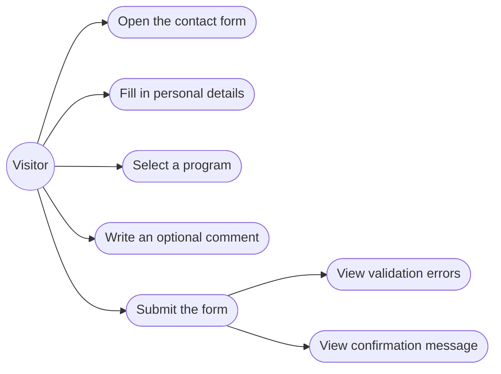
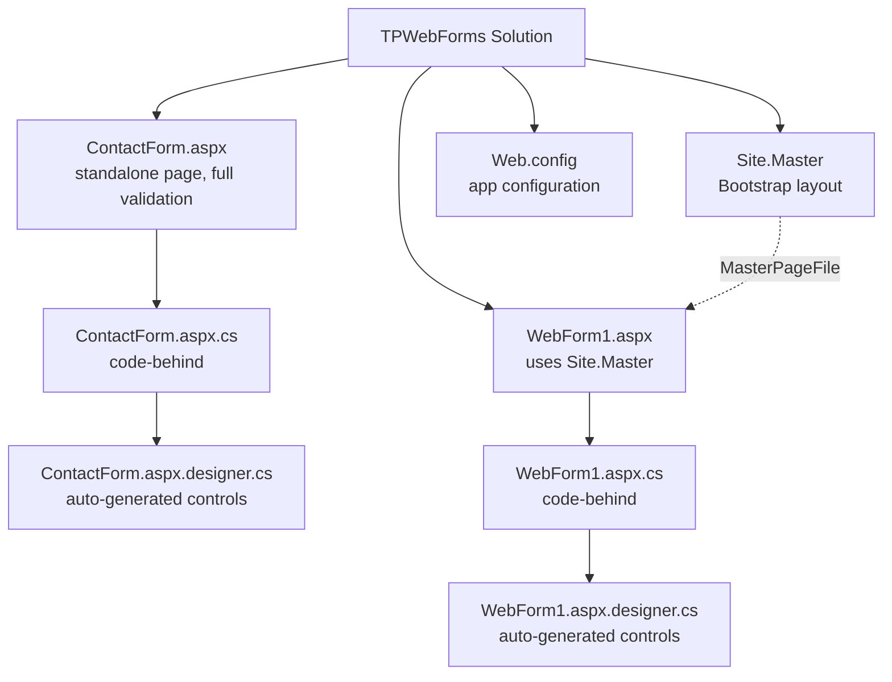
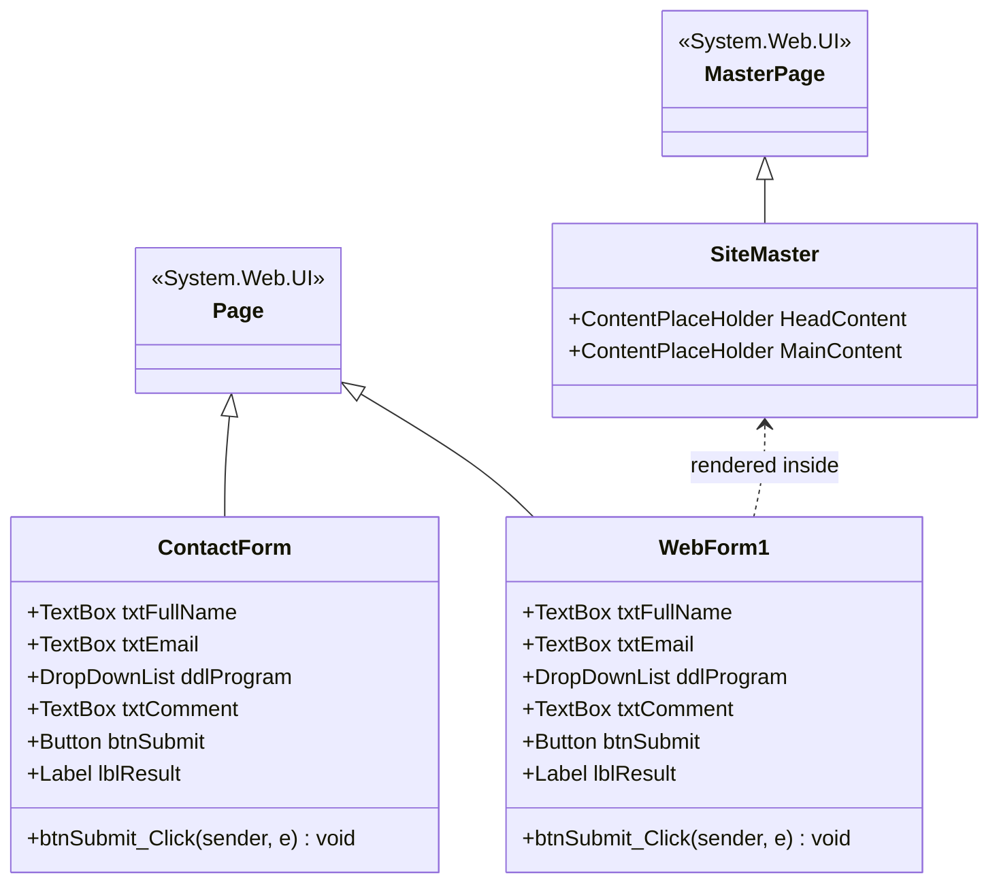
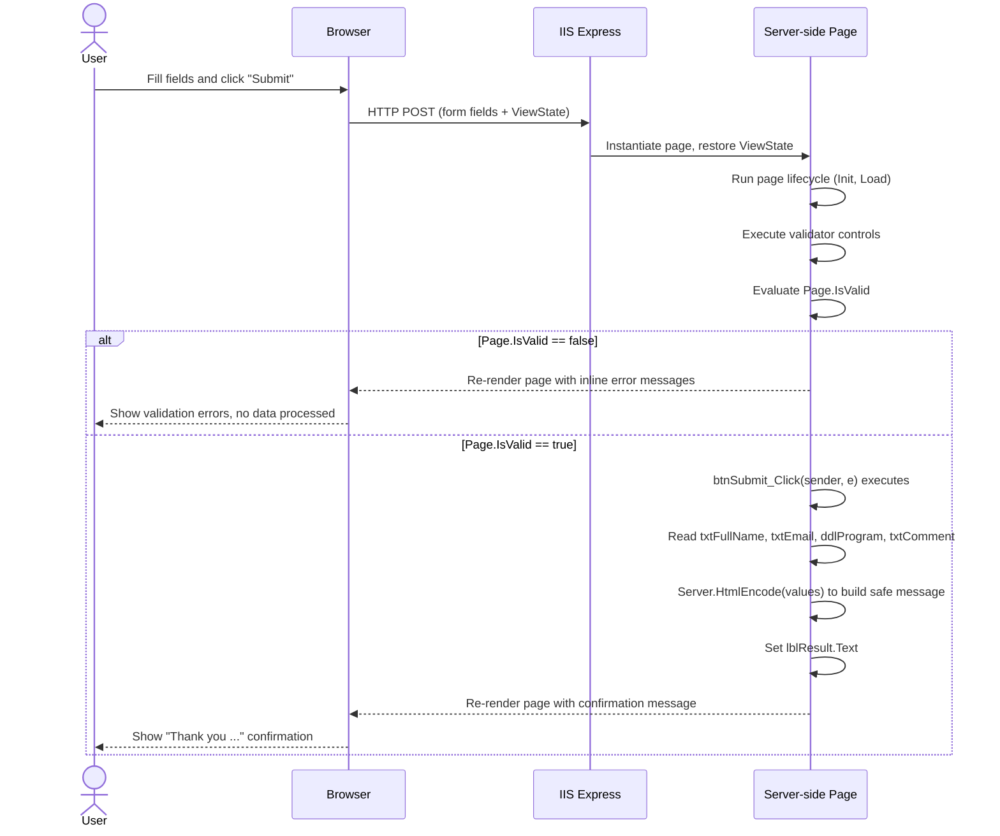
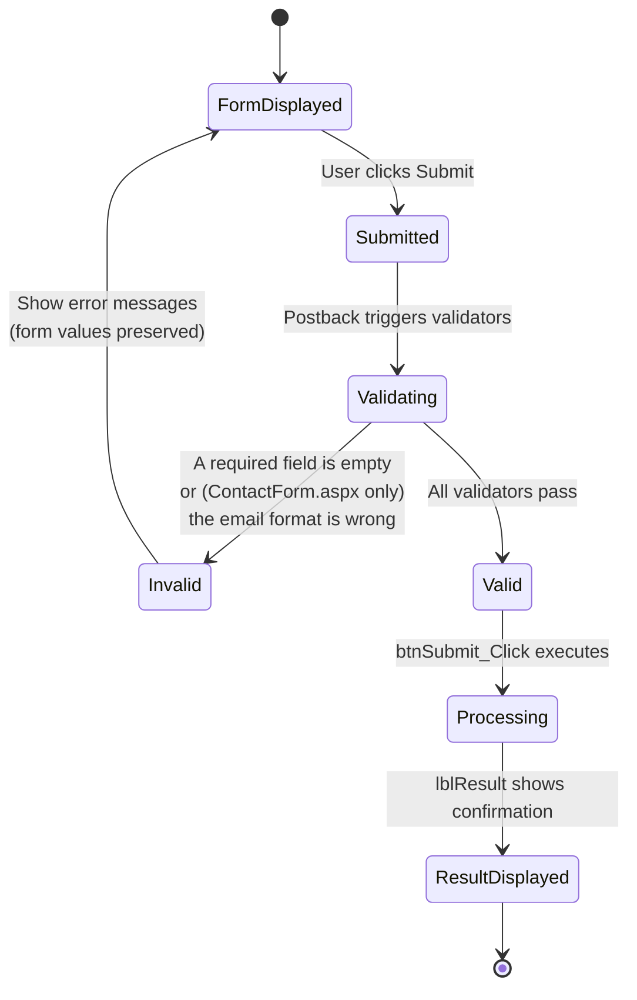

# ASP.NET Web Forms — Contact Form


*A beginner-friendly **ASP.NET Web Forms** contact form built with **C# and .NET Framework 4.8**, demonstrating server-side controls, server-side validation, the classic **postback** lifecycle, and a Bootstrap-based master page layout.*

This repository is the result of an introductory lab (*"Créer un premier formulaire ASP.NET Web Forms"*) and is intended as a **learning reference** for students who are new to ASP.NET Web Forms and to Visual Studio.

---

## Table of Contents

1. [Live Screenshots](#live-screenshots)
2. [Key Features](#key-features)
3. [Tech Stack](#tech-stack)
4. [Architecture & UML Diagrams](#architecture--uml-diagrams)
5. [Project Structure](#project-structure)
6. [Key Files at a Glance](#key-files-at-a-glance)
7. [ContactForm.aspx vs WebForm1.aspx](#contactformaspx-vs-webform1aspx)
8. [Prerequisites](#prerequisites)
9. [Quick Start](#quick-start)
10. [Full Beginner Tutorial](#full-beginner-tutorial)
11. [Testing the Application](#testing-the-application)
12. [Code Walkthrough (For Beginners)](#code-walkthrough-for-beginners)
13. [Configuration Notes](#configuration-notes)
14. [Known Limitations](#known-limitations)
15. [Suggested Exercises](#suggested-exercises)
16. [Troubleshooting](#troubleshooting)
17. [Comprehension Questions](#comprehension-questions)
18. [License](#license)

---

## Live Screenshots

> **How these were captured:** the application was actually built with MSBuild, hosted locally with **IIS Express**, and driven end-to-end with a headless **Playwright/Chrome** session that filled the real form and clicked the real **Submit** button. Every image below is a genuine response from the running app — not a mockup.

### `ContactForm.aspx` — full validation walkthrough

| Empty form | Required-field errors |
|---|---|
|  |  |

| Invalid email format rejected | Form filled correctly |
|---|---|
|  |  |

**Successful submission:**


### `WebForm1.aspx` — Bootstrap master page layout


---

## Key Features

- Server-side rendered forms built entirely with ASP.NET Web Forms server controls.
- Server-side validation using built-in validator controls — no custom JavaScript required:
  - Required full name
  - Required email address, plus **regular-expression format checking** on `ContactForm.aspx`
  - Required program/formation selection
  - Optional multi-line comment (max 500 characters)
- HTML-encoded output (`Server.HtmlEncode`) in the confirmation message to prevent reflected markup/script injection.
- Two layout variants of the same idea: a self-contained standalone page and a page sharing a Bootstrap 4 **Master Page** (`Site.Master`).
- Clean, card-style inline CSS for a modern look without any external UI framework dependency on `ContactForm.aspx`.

---

## Tech Stack

| Layer | Technology |
|---|---|
| Language | C# |
| Framework | ASP.NET Web Forms (.NET Framework 4.8) |
| Web server (dev) | IIS Express |
| Front-end styling | Inline CSS / Bootstrap 4 (CDN, via `Site.Master`) |
| IDE | Visual Studio Enterprise 2026 Insiders (Visual Studio 2022 is also fully compatible) |
| Package management | NuGet (`packages.config`) |
| Verified with | MSBuild (build) + Playwright/Chrome (functional screenshot walkthrough) |

---

## Architecture & UML Diagrams

All diagrams below are written in **Mermaid** and render natively on GitHub.

### Use Case Diagram



### Project Structure Diagram



### Class Diagram



### Sequence Diagram — Postback Lifecycle



### Activity / State Diagram — Validation Flow



---

## Project Structure

```
TPWebForms/
├── ContactForm.aspx              # Standalone contact form (markup) — full validation
├── ContactForm.aspx.cs           # Code-behind: submit handler logic
├── ContactForm.aspx.designer.cs  # Auto-generated control declarations
├── WebForm1.aspx                 # Contact form using the master page (markup)
├── WebForm1.aspx.cs              # Code-behind: submit handler logic
├── WebForm1.aspx.designer.cs     # Auto-generated control declarations
├── Site.Master                   # Shared layout with Bootstrap navbar
├── Web.config                    # Application configuration
├── Web.Debug.config              # Debug-specific config transform
├── Web.Release.config            # Release-specific config transform
├── packages.config               # NuGet package references
├── TPWebForms.csproj             # Project file (.NET Framework 4.8)
├── TPWebForms.slnx               # Visual Studio solution file
└── Properties/
    └── AssemblyInfo.cs
```

---

## Key Files at a Glance

| File | Role |
|---|---|
| `ContactForm.aspx` / `.aspx.cs` | Standalone form page — full markup + logic in one pair, no master page |
| `WebForm1.aspx` / `.aspx.cs` | Same form concept, rendered inside `Site.Master`'s Bootstrap layout |
| `*.aspx.designer.cs` | Auto-generated field declarations for server controls — never edit by hand |
| `Site.Master` | Shared page shell: Bootstrap 4 navbar + `HeadContent`/`MainContent` placeholders |
| `Web.config` | App settings, including the `UnobtrusiveValidationMode` fix (see [Configuration Notes](#configuration-notes)) |
| `TPWebForms.csproj` | MSBuild project file targeting `.NET Framework 4.8` |
| `packages.config` | NuGet package references (e.g. `Microsoft.CodeDom.Providers.DotNetCompilerPlatform`) |

---

## ContactForm.aspx vs WebForm1.aspx

While exploring the live application to capture the screenshots above, a real behavioral difference between the two pages was confirmed — worth knowing before you use either one as a template:

| Aspect | `ContactForm.aspx` | `WebForm1.aspx` |
|---|---|---|
| Layout | Self-contained `<html>` document | Uses `Site.Master` (Bootstrap navbar) |
| Full name validation | Required | Required |
| Email validation | **Required + regex format check** (`valEmailRequired`, `valEmailFormat`) | **Required only** — no format/regex validator is declared |
| Program options | Computer Engineering, Industrial Engineering, Networks and Systems | Computer Engineering, Networks and Systems *(Industrial Engineering is not listed)* |
| Comment field | Optional, max 500 characters | Optional, max 500 characters |

> This was verified by posting directly to each page: submitting `youssef@invalid` to `ContactForm.aspx` correctly triggers *"Enter a valid email address."*, while the same value submitted to `WebForm1.aspx` is silently accepted because no `RegularExpressionValidator` exists on that page. If you build on `WebForm1.aspx`, consider adding the same email-format validator used in `ContactForm.aspx`.

---

## Prerequisites

| Tool | Why you need it |
|---|---|
| Windows computer | Visual Studio + IIS Express are Windows-only |
| **Visual Studio 2022 (Community+)** or **Visual Studio Enterprise 2026 Insiders** | IDE used to build and run the project (this repo was built with VS Enterprise 2026 Insiders) |
| **"ASP.NET and web development"** workload | Installed via the Visual Studio Installer; required for Web Forms templates |
| **".NET Framework project and item templates"** component | Makes the Web Forms project template available |
| **.NET Framework 4.8** | Target framework of this project |

> **Important:** ASP.NET Web Forms runs on **.NET Framework**, not .NET Core / .NET 5+. When creating a new project, do not pick an "ASP.NET Core" template — it is a different technology and will not match this lab.

---

## Quick Start

For readers already comfortable with Visual Studio:

```text
1. Open TPWebForms.slnx (or TPWebForms.sln) in Visual Studio.
2. Right-click the solution → Restore NuGet Packages (if prompted).
3. Right-click ContactForm.aspx or WebForm1.aspx → Set As Start Page.
4. Press F5 (debug) or Ctrl+F5 (no debug).
5. Visual Studio launches IIS Express and opens your default browser.
```

If you are new to Visual Studio or ASP.NET Web Forms, continue to the [Full Beginner Tutorial](#full-beginner-tutorial) below.

---

## Full Beginner Tutorial

### Part A — Installing Visual Studio

1. Download **Visual Studio** from the official Visual Studio website (Community edition is free and sufficient; this project was built with Visual Studio Enterprise 2026 Insiders).
2. Run the downloaded installer.
3. In the **"Workloads"** tab, check **"ASP.NET and web development"**.
4. Open the **"Individual components"** tab and confirm that **".NET Framework project and item templates"** is checked.
5. Click **Install** (or **Modify**, if Visual Studio is already installed) and wait for the installer to finish.
6. Launch Visual Studio once installation completes.

> 🖼️ **Screenshot still needed from you:** the IDE-level steps below involve your personal Visual Studio window, which is outside what an automated script can capture on your behalf. Take a screenshot of the Visual Studio Installer with the **"ASP.NET and web development"** workload checked and save it as `docs/screenshots/step-01-installer-workload.png` — it will then render automatically in this section.

### Part B — Opening and Running the Project

1. Launch **Visual Studio** and open `TPWebForms.slnx`.
2. In **Solution Explorer**, confirm the tree matches [Project Structure](#project-structure): `Site.Master`, `ContactForm.aspx`, `WebForm1.aspx`, `Web.config`, etc.
3. If Visual Studio shows a NuGet warning banner, right-click the solution → **"Restore NuGet Packages"**.
4. Right-click `ContactForm.aspx` (or `WebForm1.aspx`) → **"Set As Start Page"**.
5. Press **F5** to run with debugging, or **Ctrl+F5** to run without debugging.
6. Visual Studio starts **IIS Express** and opens your browser at an address such as `https://localhost:44373/ContactForm.aspx`.

> 🖼️ **Screenshots still needed from you** (personal IDE steps, same reasoning as above):
> - `docs/screenshots/step-02-open-solution.png` — Visual Studio opening `TPWebForms.slnx`
> - `docs/screenshots/step-03-solution-explorer.png` — Solution Explorer showing the project tree
> - `docs/screenshots/step-04-set-start-page.png` — right-click menu with **"Set As Start Page"**
>
> The **running application itself** is already shown above in [Live Screenshots](#live-screenshots) — that part was captured automatically.

---

## Testing the Application

This is the exact scenario sequence used to produce the screenshots in [Live Screenshots](#live-screenshots), so you can reproduce it yourself:

1. **Load the page.** Observe the title, the four fields (Full name, Email address, Program, Comment) and the **Submit** button. → *[Empty form](docs/screenshots/step-05-running-app.png)*
2. **Submit the empty form.** Click **Submit** without typing anything — every required field shows its own red validation message. → *[Required-field errors](docs/screenshots/step-06-empty-validation.png)*
3. **Enter a syntactically-invalid email** (e.g. `youssef@invalid`, missing a dot), fill the other required fields, and submit — on `ContactForm.aspx` the format validator blocks it. → *[Invalid email error](docs/screenshots/step-07-invalid-email.png)*
4. **Fill the form correctly**: full name, a valid email, a selected program, and an optional comment. → *[Form filled correctly](docs/screenshots/step-08-filled-correctly.png)*
5. **Click Submit.** A confirmation message appears below the button, repeating the submitted name, program, and email. → *[Success confirmation](docs/screenshots/step-09-confirmation.png)*
6. **Change the comment and submit again** to confirm the form can be resubmitted and the confirmation message updates accordingly.

---

## Code Walkthrough (For Beginners)

If you are new to ASP.NET Web Forms, this section explains what each file does and how they connect.

### `.aspx` vs `.aspx.cs` vs `.aspx.designer.cs`

| File | Role |
|---|---|
| `WebForm1.aspx` | The **markup** file: HTML plus ASP.NET server control tags (`<asp:TextBox>`, `<asp:Button>`, …). This is what defines the visual layout. |
| `WebForm1.aspx.cs` | The **code-behind** file: C# logic that runs on the server, such as the `btnSubmit_Click` event handler. |
| `WebForm1.aspx.designer.cs` | **Auto-generated** by Visual Studio. It declares one C# field per server control (matched by `ID`) so the code-behind can reference `txtFullName`, `ddlProgram`, etc. **Never edit this file manually** — Visual Studio regenerates it whenever the markup changes. |

### `runat="server"`

Any HTML/ASP.NET control marked `runat="server"` becomes an object that the C# code-behind can read and modify (for example `txtFullName.Text`). Without this attribute, a control is just static HTML and the server cannot interact with it.

### The postback model

ASP.NET Web Forms uses a **postback**: clicking the Submit button sends the entire form back to the *same* page via an HTTP POST. The server re-creates the page, restores its state (via **ViewState**), runs the validators, and then executes the event handler tied to the button (`OnClick="btnSubmit_Click"`). The result is rendered back into the same page — there is no separate "results" page. This flow is detailed in the [sequence diagram](#architecture--uml-diagrams) above.

### Validator controls

Instead of writing manual `if` checks in C#, the markup declares validator controls next to each input:

- `RequiredFieldValidator` — blocks submission if the associated field is empty. Used for full name, email, and program on both pages.
- `RegularExpressionValidator` — checks the email field against `^[^@\s]+@[^@\s]+\.[^@\s]+$`. **Only present on `ContactForm.aspx`** (see [comparison table](#contactformaspx-vs-webform1aspx)).

Before processing any data, the code-behind checks:

```csharp
if (!Page.IsValid)
{
    lblResult.Text = "";
    return;
}
```

`Page.IsValid` becomes `true` only if every validator on the page passed. This prevents the handler from processing incomplete or malformed data.

### The submit handler

```csharp
protected void btnSubmit_Click(object sender, EventArgs e)
{
    if (!Page.IsValid)
    {
        lblResult.Text = "";
        return;
    }

    string fullName = txtFullName.Text.Trim();
    string email = txtEmail.Text.Trim();
    string program = ddlProgram.SelectedItem.Text;
    string comment = txtComment.Text.Trim();

    lblResult.Text = "Thank you " + Server.HtmlEncode(fullName) +
                     "! Your form was processed. " +
                     "Program: " + Server.HtmlEncode(program) +
                     ". A summary could be sent to " +
                     Server.HtmlEncode(email) + ".";

    // The comment is read, but the submitted information is not stored.
}
```

Key points for beginners:

- `Server.HtmlEncode(...)` escapes any HTML/script characters the user typed, so the confirmation message cannot be used to inject markup into the page (basic XSS protection).
- The comment field is read into a local variable purely to demonstrate retrieving a multi-line input — it is not persisted anywhere.
- `lblResult` is an `asp:Label` with `EnableViewState="false"`, meaning its text is not remembered across further postbacks unless explicitly set again.

### The Master Page (`Site.Master`)

`WebForm1.aspx` declares `MasterPageFile="~/Site.Master"`. The master page defines the outer HTML shell, the Bootstrap 4 navigation bar, and two placeholders:

- `HeadContent` — lets child pages inject extra `<head>` content (e.g., page-specific `<style>` blocks).
- `MainContent` — where the child page's body content is inserted.

Because `WebForm1.aspx` lives inside `MainContent`, its rendered control IDs are prefixed (e.g. `MainContent_txtEmail`) — useful to know if you ever need to reference them from custom JavaScript.

`ContactForm.aspx`, by contrast, does **not** use a master page — it defines its own complete `<html>` document, which is why its markup includes a full `<head>` and `<body>`, and why its rendered IDs have no prefix.

---

## Configuration Notes

`Web.config` contains this setting:

```xml
<appSettings>
  <add key="ValidationSettings:UnobtrusiveValidationMode" value="None" />
</appSettings>
```

By default, ASP.NET Web Forms uses **unobtrusive client-side validation**, which relies on jQuery being correctly mapped as a script resource. For a first lab that focuses on **server-side** validators, setting this mode to `None` avoids a configuration error and keeps the example simple (see [Troubleshooting](#troubleshooting) below).

---

## Known Limitations

- **No persistence.** Submitted data is used only to build the confirmation message for that single request; nothing is written to a database, file, or session.
- **No authentication or authorization.** The form is open to any visitor.
- **No anti-forgery/CSRF token.** Acceptable for a local teaching lab, but would need to be addressed before any real-world deployment.
- **Inconsistent validation between pages.** `WebForm1.aspx` does not validate email format (see [comparison table](#contactformaspx-vs-webform1aspx)) — confirmed during manual testing, not just a theoretical gap.
- **Minimal styling**, intended to keep the markup readable for beginners rather than to be production-ready UI.

---

## Suggested Exercises

To practice further with this codebase, try implementing:

- Add a **"Phone number"** field and make it required.
- Add a **"Education level"** dropdown list.
- Add a **"Reset"** button that clears all fields and the confirmation message.
- Display a more complete summary of all submitted information (including the comment).
- Add a **live character counter** for the comment field (maximum 500 characters).
- Bring `WebForm1.aspx` up to parity with `ContactForm.aspx` by adding the missing email-format validator and the missing "Industrial Engineering" program option.

---

## Troubleshooting

| Symptom | Cause | Fix |
|---|---|---|
| *"WebForms UnobtrusiveValidationMode requires a ScriptResourceMapping for 'jquery'..."* | The default unobtrusive validation mode expects a jQuery script mapping that isn't configured in this minimal project. | Ensure `Web.config` contains the `appSettings` entry shown in [Configuration Notes](#configuration-notes). |
| An obviously malformed email (e.g. `youssef@invalid`) is accepted on `WebForm1.aspx` | That page only declares a `RequiredFieldValidator` for the email field — no format validator | Expected behavior for this page (see [comparison table](#contactformaspx-vs-webform1aspx)); use `ContactForm.aspx` if you need format checking, or add a `RegularExpressionValidator` to `WebForm1.aspx`. |
| `MSB1008` / command-line build errors mentioning stray paths | Running MSBuild from a Unix-style shell (e.g. Git Bash) mangles `/p:` style switches | Run MSBuild from PowerShell or the Developer Command Prompt instead. |

---

## Comprehension Questions

These questions are useful for self-assessment after completing the lab:

1. What is the difference between `WebForm1.aspx` and `WebForm1.aspx.cs`?
2. What does the `runat="server"` attribute do?
3. What role does the `btnSubmit_Click` event play?
4. Why does the code check `Page.IsValid` before processing the submitted fields?
5. What happens if the browser is closed after submitting the form? Is the data kept? Why or why not?
6. Why does submitting an invalid email format get blocked on `ContactForm.aspx` but not on `WebForm1.aspx`?

---

## License

This project is distributed under the **MIT License** and is intended for educational purposes as part of an ASP.NET Web Forms introductory lab.
